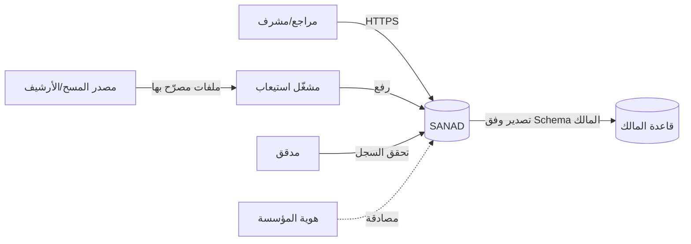
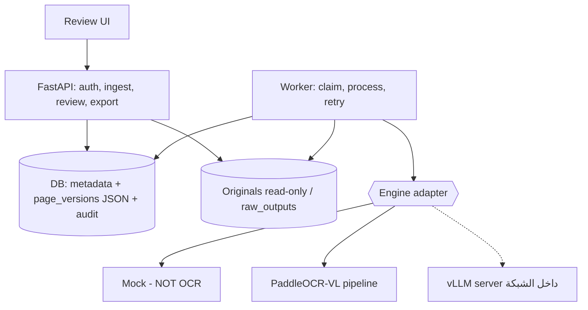
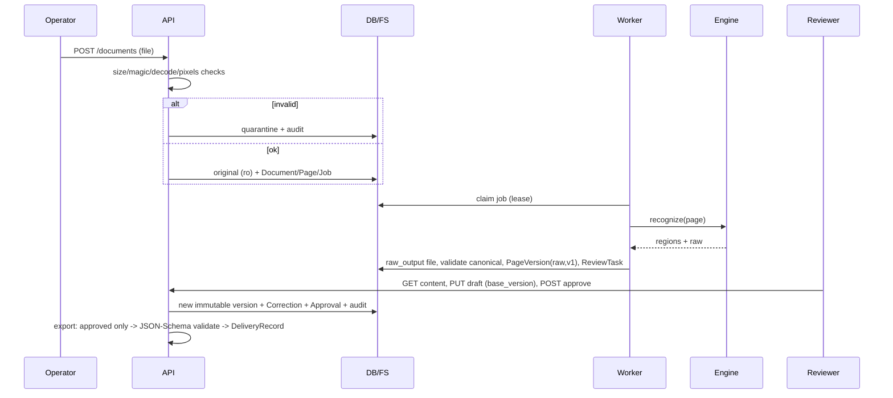
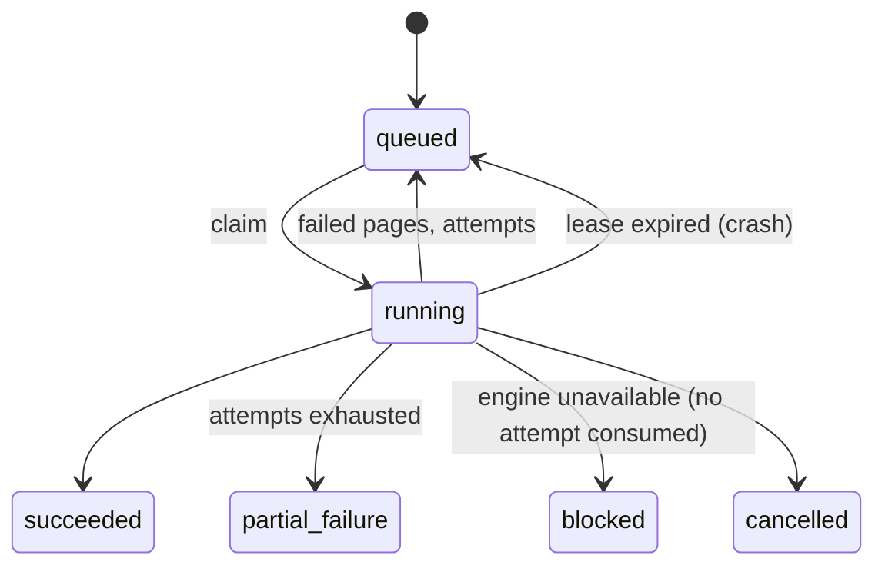
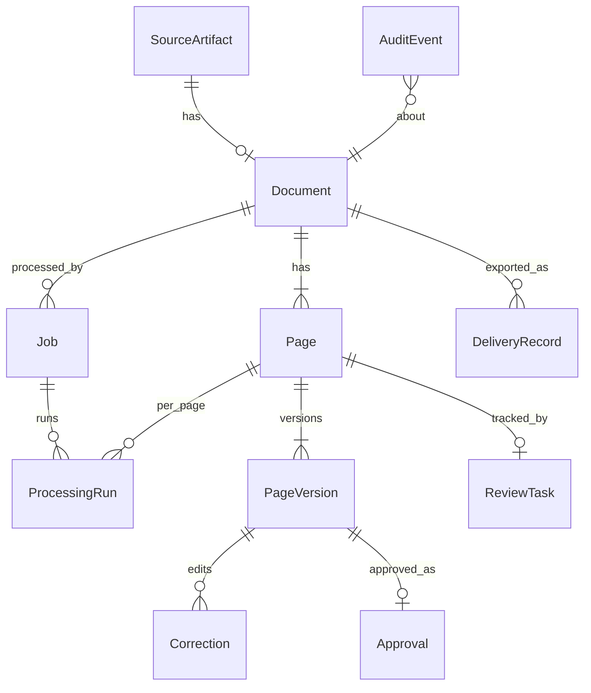

# SANAD — المعمارية (مقترح هندسي، غير مُتحقَّق منه على وثائق الوزارة)

**مفتاح التصنيف:** [مؤكد] متطلب من النطاق · [مقترح] قرار هندسي مؤقت · [افتراض] · [قرار المالك] · [مُتحقَّق] نتيجة قياس (لا توجد بعد).

## A. التوصية التنفيذية
1. **معمارية Modular Monolith + عمّال معالجة منفصلين** [مقترح]: واجهة FastAPI واحدة، عامل Python واحد أو أكثر، قاعدة بيانات (SQLite للتطوير، PostgreSQL للتجربة المعتمدة)، تخزين ملفات مُعنوَن بالمحتوى (sha256). بلا Kubernetes ولا قواعد رسومية/متجهية في التجربة.
2. **استراتيجية المحركات مقارِنة لا حاسمة** [مقترح]: خط PaddleOCR-VL الكامل (تحليل التخطيط + VLM) هو المرشح الأساسي للصفحة الكاملة؛ `arabic_PP-OCRv5_mobile_rec` خط أساس لسطور الطباعة العربية؛ المخطوط والمختلط يُقيَّمان بشكل منفصل؛ كل شيء خلف واجهة محوّلات محايدة للإصدار.
3. **سلامة المحتوى:** طبقات منفصلة (أصل ← خام ← قانوني ← تصحيحات ← معتمد ← بحث) لا يُكتب فوق أي منها.
4. **لا ادعاء بدقة** على وثائق الوزارة قبل القياس على عينة مصرّح بها.

## B. النطاق، الافتراضات، المعوِّقات
| الفئة | البند |
|---|---|
| [مؤكد] | رقمنة المحتوى الكامل؛ حفظ الأصل وترتيب الصفحات والبنية؛ طباعة/خط يد/مختلط/جداول/هوامش/أختام؛ ربط النص بموضع المصدر؛ تخزين وفق Schema المالك؛ مراجعة وتصحيح واعتماد واسترجاع |
| خارج النطاق (يحتاج اعتماداً مستقلاً) | قرار قضائي/استشارة قانونية، تفسير قانوني آلي، ربط هوية الأشخاص أو القضايا، رسوم علاقات، تحليلات تنبؤية |
| [افتراض] | رقم الـ250 مليون "وثيقة" غير مُتحقَّق؛ لا يُفترض أنه صفحات. متوسط الصفحات وأحجام الملفات = مجهول حتى القياس |
| [قرار المالك] | Schema الهدف وقاعدة البيانات، العتاد/GPU، بيئة النشر، قيود الشبكة، عتبات القبول، واجهات التكامل، الاحتفاظ والحذف، IdP |
| معوِّق فوري | عيّنة وثائق ممثِّلة + تصريح وصول. بدونها: وضع التطوير فقط (اصطناعي/عام) |

**وضعان:** (A) تطوير: مواد اصطناعية موسومة `is_synthetic_demo`، محرك mock، رموز demo. (B) تجربة معتمدة: `SANAD_ENV=secure`، IdP، قاعدة PostgreSQL، لا معالجة خارجية، لا رفع لأي وثيقة خارج البيئة بلا تفويض مؤسسي.

## C. معمارية التجربة والتطور للإنتاج
| البُعد | التجربة (6 أسابيع) | الإنتاج (بعد التحقق) [مقترح] |
|---|---|---|
| الحوسبة | API + عامل/عمّال | عمّال متعددون ومجمّعات GPU/CPU منفصلة |
| الطابور | جدول `jobs` مع lease | وسيط رسائل مع نفس عقد `run_once` |
| الملفات | قرص محلي مُعنوَن بالـhash | تخزين كائني مشفّر + نسخ احتياطي |
| قاعدة البيانات | SQLite/PostgreSQL | PostgreSQL HA + أرشفة إصدارات |
| البحث | غير مطلوب | فهرس مشتق قابل لإعادة البناء من الإصدارات المعتمدة |
| VLM | في-العملية أو خادم vLLM محلي | خادم استدلال مخصّص على عتاد مقاس |

## D. المخططات
### سياق النظام

### الحاويات

## E. تسلسل المعالجة

## F. الحالات

```mermaid
stateDiagram-v2
  [*] --> ingested
  ingested --> processing
  processing --> in_review
  processing --> partial_failure
  processing --> blocked
  in_review --> approved: all pages approved
  approved --> in_review: supervisor reopen (new draft; approved row kept)
```


## G. النموذج القانوني (canonical-0.1)

`Region/TextLine/Table/TableCell` و`EngineConfiguration` و`Region` تُخزَّن **داخل** JSON الإصدار (`page_versions.content`) وليس صفاً لكل كلمة؛ `EngineConfiguration` داخل `processing_runs.config`.
**لماذا لا صف لكل Token؟** في 250M وثيقة × صفحات × مئات الرموز ينتج مليارات الصفوف دون فائدة للمراجعة (التي تعمل على مستوى المنطقة/الصفحة) ويضاعف كلفة الفهرسة؛ البديل: بيانات وصفية علائقية + أصل JSON بإصدارات + فهرس بحث مشتق قابل لإعادة البناء. الاستثناء: إن فرض Schema المالك نصاً على مستوى الكلمة يُنتَج وقت التصدير.

```json
{
  "schema_version": "canonical-0.1", "page_id": "…", "page_no": 1, "width": 800, "height": 1100, "rotation": 0,
  "coordinate_system": "pixel_top_left_original", "source_sha256": "…64 hex…",
  "regions": [
    {"region_id": "r2", "label": "text", "bbox": [80,165,720,550], "text": "…النص الحرفي كما ظهر…",
     "status": "recognized", "reading_order": 1, "engine_score": null, "engine_score_kind": null, "flags": []},
    {"region_id": "r3", "label": "seal", "bbox": [480,660,680,880], "text": null,
     "status": "not_processed", "reading_order": 2, "flags": ["non_text_region"]}
  ]
}
```
سياسة الإصدارات: `canonical-MAJOR.MINOR`؛ MINOR إضافات اختيارية، MAJOR بترحيل صريح؛ الإصدارات المخزّنة لا تُعدَّل بل تُرحَّل إلى صف جديد؛ الاعتماد السابق يبقى. الهجرة: Alembic عند الانتقال لـPostgreSQL (حالياً `create_all` — **معلّق**).
**الحالات:** `recognized/uncertain/illegible/not_present/not_processed/requires_review` تُطبَّق على **المناطق** (والخلايا)؛ حقول Schema المالك المهيكلة تأخذ صلاحيتها من حالة المنطقة المصدر + قاعدة تحقق المالك (غائب ≠ غير مقروء). `engine_score` يُحفظ فقط إن وفّره المحرك ولا يُعامَل كدقة معايَرة.

## H. عقود المكوّنات
| المكوّن | المسؤولية | مدخل ← مخرج | أعطال | يعتمد على | للتجربة | المنفّذ المقترح |
|---|---|---|---|---|---|---|
| Ingestion `ingest.py` | تحقق/حجر/حفظ الأصل | bytes ← Artifact/Document/Job | تالف، كبير، قنبلة بكسلات | Pillow | نعم (منفَّذ) | عبدالرحمن عنتر + مصطفى |
| الحجر/تكرار الملفات | فصل المرفوض؛ hash | — | تكرار ≠ تكرار قانوني | DB | نعم (منفَّذ) | عبدالرحمن إبراهيم |
| تقييم جودة الصورة | علامات (ضبابية/ميل/تباين) | صورة ← flags | إيجابيات كاذبة | OpenCV | معلّق | شادية |
| المعالجة المسبقة (تجريبية) | اتجاه/تسوية/تظليل/dewarp بإعدادات مخزّنة وخريطة إحداثيات للأصل | صورة ← صورة+metadata | تدهور القراءة | محرك | معلّق (تجربة) | شادية |
| التخطيط وترتيب القراءة | مناطق+ترتيب+جداول | صفحة ← regions | تقطيع خاطئ RTL | PaddleOCR-VL layout | عبر المحوّل | أسماء |
| محوّلات المحركات | عقد `RecognitionEngine` | صفحة ← EngineResult | غياب العتاد → `blocked` | paddle/vLLM | mock منفَّذ؛ Paddle غير مُختبَر | ندى (مطبوع)، عبدالرحمن الشيخ (مخطوط) |
| التحقق من المخرجات | `CanonicalPage` صارم | raw ← canonical | بلا bbox ⇒ رفض الصفحة | pydantic | نعم (منفَّذ) | مصطفى |
| المراجعة والإصدارات | drafts/اعتماد/إعادة فتح | edits ← versions | تعارض ⇒ 409 | DB | نعم (منفَّذ) | عنتر + أمنية |
| محوّل Schema المالك | JSON-Schema → تسليم/رفض | approved ← payload | فشل تحقق ⇒ رفض كامل | Schema المالك | نعم (Schema مؤقت) | مصطفى + مي |
| المهام والإعادة | lease، backoff، حدود | job ← runs | انهيار عامل | DB | نعم (منفَّذ) | عبدالرحمن إبراهيم |
| المصادقة والصلاحيات | دور + نطاق مؤسسي | token ← Principal | تسرّب بين الجهات | IdP | نعم (dev) | عنتر |
| السجل التدقيقي | سلسلة هاش | event ← chain | تلاعب ⇒ كشف | DB | نعم (منفَّذ) | عبدالرحمن إبراهيم |
| المراقبة/النسخ الاحتياطي/الاستعادة | `/healthz` `/readyz` سجلات JSON؛ النسخ **معلّق** | — | — | البنية | جزئي | إبراهيم + قرار المالك |
| تحويل PDF إلى صور | — | — | — | — | **معلّق** (يُرفض الآن) | شادية |

## I. مواصفة API (`/api/v1`)
| الطريقة | المسار | الصلاحية | ملاحظات |
|---|---|---|---|
| POST | /documents | ingest + نطاق | multipart؛ 201 مع `accepted` أو `quarantined`؛ التكرار يعيد نفس المعرّف |
| GET | /documents/{id} | read_content | 404 خارج النطاق، 403 عند نقص الدور |
| GET | /pages/{id}/image | read_content | يُسجَّل في التدقيق |
| GET | /pages/{id}/content | read_content | آخر إصدار + السجل + التصحيحات |
| PUT | /pages/{id}/draft | edit | `base_version_no` إلزامي؛ 409 عند التعارض |
| POST | /pages/{id}/approve | approve | يمنع المناطق `uncertain/requires_review`؛ idempotent |
| POST | /pages/{id}/reopen | reopen (مشرف) | سبب إلزامي |
| POST | /documents/{id}/export | export | المعتمد فقط؛ رفض كامل عند فشل التحقق |
| GET | /audit/verify | read_audit | سلامة السلسلة |
| GET | /healthz, /readyz | — | — |
**معلّق:** مسارات التعيين/التصعيد عبر HTTP (الدوال موجودة في `review.py`)، قائمة المهام، الإلغاء عبر HTTP.

## K. سير المراجعة
الواجهة (`/review`): صورة + مربعات المناطق + نص قابل للتحرير + حالة الإصدار + تحذير mock. الحفظ ينتج **draft** لا اعتماداً؛ الاعتماد صريح؛ التعارض بإصدار القاعدة (`UNIQUE(page_id, version_no)` + فحص `base_version_no`)؛ إعادة الفتح للمشرف فقط وتُبقي الصف المعتمد. سياسة مراجعة مبنية على المخاطر [مقترح، العتبات قرار المالك]: صفحات بها مناطق `uncertain/illegible/requires_review`، خط يد، جداول، أرقام/تواريخ حرجة ← مراجعة إلزامية؛ عيّنة جودة للباقي. التجربة تركّز على إثبات التتبّع وسير العمل لا على نسب.

## L. الأمن والنشر
| المجال | التصميم | الحالة |
|---|---|---|
| الهوية | واجهة `principal_from_token` قابلة للاستبدال بـOIDC/LDAP/AD | رموز demo فقط للتطوير؛ `secure` يرفضها |
| الصلاحيات | دور + نطاق جهة؛ `admin` بلا صلاحيات محتوى؛ 404 بين الجهات | منفَّذ ومُختبَر |
| التشفير | TLS عند البوابة؛ تشفير القرص/قاعدة البيانات | **قرار المالك/بنية** |
| الأسرار | متغيرات بيئة/خزنة؛ لا اعتماد في المستودع | `.gitignore`؛ لا أسرار في الكود |
| التدقيق | سلسلة هاش (كشف تلاعب لا منعه) + تثبيت الرأس خارجياً في الإنتاج | منفَّذ (السلسلة) |
| نص الوثائق = مدخل غير موثوق | لا تنفيذ تعليمات داخله؛ المحرك بلا أدوات/روابط؛ مخرجات تُتحقَّق بعقد صارم؛ مسارات من الـhash فقط | منفَّذ جزئياً |
| ملفات خبيثة | حد حجم/بكسلات، فك ترميز كامل، حجر | منفَّذ |
| تصدير | `export` للمشرف؛ معتمد فقط | منفَّذ؛ ضوابط إضافية قرار المالك |
| الاحتفاظ/الحذف | — | **قرار المالك** |
| التثبيت دون إنترنت | صور Docker الرسمية "offline" لـPaddleOCR-VL موثقة؛ نسخها وفحصها داخلياً + تثبيت hash للأوزان | مُخطَّط |
لا ادعاء بامتثال أو شهادة.
